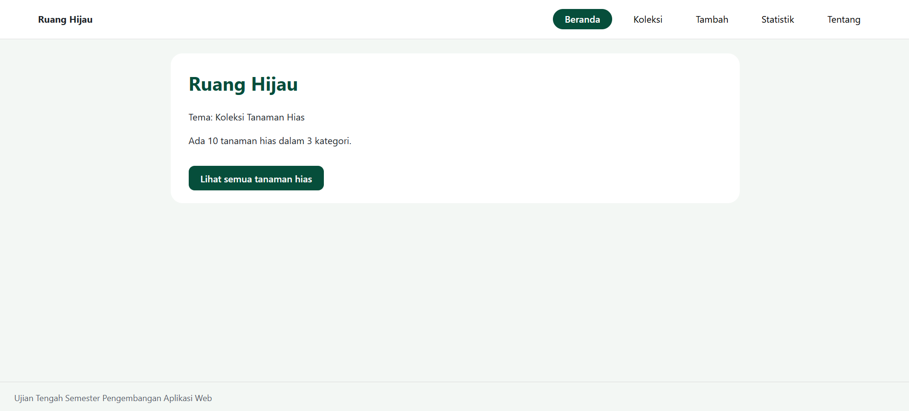
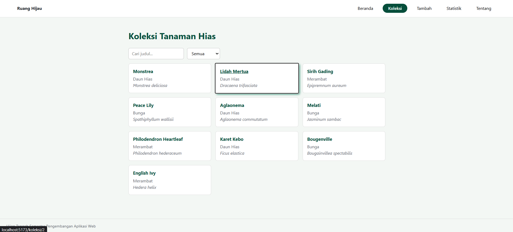
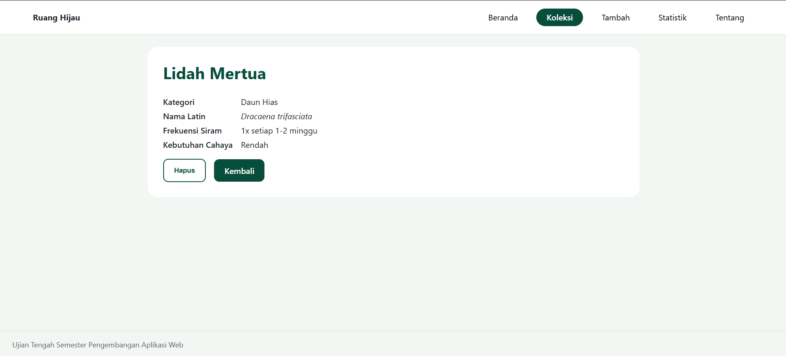
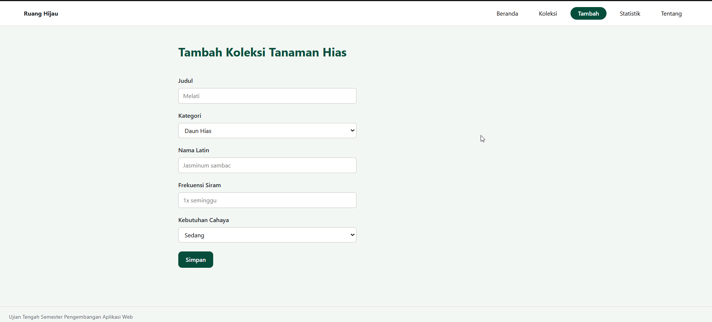
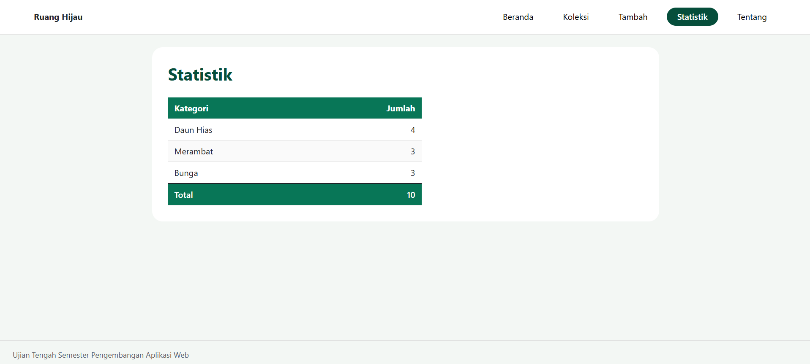
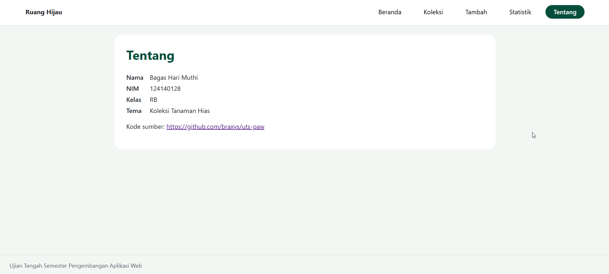

# Ujian Tengah Semester IF25-22014 Pengembangan Aplikasi Web

# Ruang Hijau

| Identitas | |
| :--- | :--- |
| Nama | Bagas Hari Muthi |
| NIM | 124140128 |
| Kelas | RB |
| Tema | Koleksi Tanaman Hias |
| Deployment | https://braxys.github.io/uts-paw/ |

---
## Tangkapan Layar Halaman Aplikasi Ruang Hijau
| No. | Halaman | Tangkapan Layar |
| :---: | :---: | :---: |
| 1. | Beranda |  |
| 2. | Koleksi |  |
| 3. | Detail |  |
| 4. | Tambah |  |
| 5. | Statistik |  |
| 6. | Tentang |  |

## Fitur

- Menampilkan ringkasan statistik total tanaman dan jumlah kategori tanaman hias.
- Menampilkan seluruh data tanaman hias, dilengkapi fitur pencarian berdasarkan judul dan filter berdasarkan kategori.
- Menampilkan detail lengkap tanaman beserta fitur hapus data.
- Menambahkan koleksi tanaman hias baru.
- Menyajikan data statistik jumlah tanaman hias per kategori dan totalnya.

## Menjalankan secara lokal

```bash
cd app
npm install
npm run dev
```

## Konsep React yang dipakai

- React State & Props: Pengelolaan state lokal (useState) dan pengiriman data antar komponen via props.
- Custom Hooks: Pembuatan hook khusus useLocalStorage dan useKoleksi.
- React Router: Pengaturan navigasi SPA 7 rute (BrowserRouter, Routes, Route, NavLink, Link, useParams, useNavigate).
- Async Data Fetching: Pengambilan data awal dari berkas JSON secara asinkron menggunakan fetch dan useEffect.
- Testing: Pengujian unit dan integrasi berbasis Vitest dan React Testing Library.
